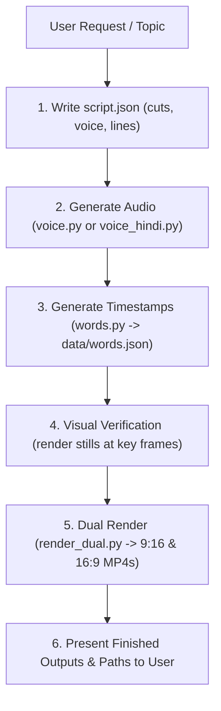

# Faceless Shorts & Long-Form Video Engine 🎬

> **100% Code-Driven 3D Video Production for AI Agents & Humans.**
> Create narrated videos with real 3D animation, spring motion graphics, local Kokoro/Hindi AI voices, and word-synced kinetic captions.
> **$0 external cost — No paid APIs, no image/video generative subscriptions, no render credits.**

---

## 🌟 Key Capabilities

1. **Dual-Format Architecture (9:16 Shorts + 16:9 Long-Form)**
   - Render the exact same script, narration, duration, and 3D scenes into both:
     - **Vertical 9:16 (`1080x1920`)**: Optimized for YouTube Shorts, Instagram Reels, and TikTok (safe zone above platform UI).
     - **Horizontal 16:9 (`1920x1080`)**: Optimized for standard YouTube and widescreen monitors (wide 180m panoramic terrain, lower-third captions).
2. **True 3D Realism (Remotion + Three.js + React Three Fiber)**
   - Physically based lighting: directional key sun with real shadow casting, warm golden rim lights, and soft fill.
   - Procedural characters with realistic kinematic walk cycles (hip bob, lateral weight sway, alternating leg strides, knee bends, arm swing).
   - Rich 3D environments: asphalt road, painted yellow center dashes, concrete curbs, sidewalks, glowing streetlamps with point lights, roadside trees, and city skylines.
3. **Kinetic Whisper Word-Synced Captions**
   - Word-level synchronization from Whisper timestamps (`words.json`).
   - Spring-powered scale bounce on spoken words with high-contrast ink outlines.
   - Automatically adapts font size, margins, and chunk size between 9:16 and 16:9.
4. **Local Audio Pipeline ($0 Cost, Offline)**
   - **English**: Kokoro-82M TTS (`scripts/voice.py`).
   - **Hindi**: Edge TTS emotional voice pipeline (`scripts/voice_hindi.py`).
   - **User Voice**: Drop your phone's voice memo (`.m4a` / `.wav` / `.mp3`), Whisper syncs the words automatically.

---

## 📁 Repository Structure

```
faceless-shorts/
├── remotion/                      # Remotion + Three.js 3D Video Engine
│   ├── Root.tsx                   # Master composition registry & dynamic metadata
│   ├── index.ts                   # Remotion entrypoint
│   ├── types.ts                   # TypeScript interfaces (WordTiming, Props, etc.)
│   ├── components/
│   │   ├── ShortVideo.tsx         # Unified video wrapper (3D Scene + Captions + Audio)
│   │   ├── ThreeCanvasScene.tsx   # <ThreeCanvas> with PBR lighting, shadows & fog
│   │   ├── CameraRig.tsx          # Spring camera rigs (dolly, orbit, heroZoom, sideTrack)
│   │   ├── WalkingHumanoid.tsx    # Procedural 3D walking character with kinematics
│   │   └── KineticCaptions.tsx    # Whisper-synced responsive captions overlay
│   └── scenes/
│       ├── WalkingRoadScene.tsx   # True 3D road, sidewalks, streetlamps & trees
│       ├── Explainer3DScene.tsx   # Deep Dive 3D science & x-ray anatomical scene
│       └── Mystery3DScene.tsx     # Night File 3D true-crime & spotlight scene
├── scripts/                       # Audio, Timing, & Dual-Render Tools
│   ├── render_dual.py             # One-command dual format renderer (9:16 + 16:9)
│   ├── voice.py                   # Kokoro TTS narration generator (English)
│   ├── voice_hindi.py             # Emotional Hindi voice generator
│   ├── words.py                   # Whisper word-timestamp generator (data/words.json)
│   ├── estimate.py                # Fast word timing estimator
│   ├── py                         # Virtual environment python runner wrapper
│   ├── setup.sh                   # Environment & dependency check
│   └── selftest.sh                # End-to-end self-test suite
├── projects/                      # Individual video project folders
│   └── <project-name>/
│       ├── script.json            # Script lines, cuts, and voice settings
│       ├── data/
│       │   ├── words.json         # Whisper word timestamps (start, end, text)
│       │   └── mix.wav            # Master narration/mix audio track
│       └── renders/               # Output MP4 videos
├── package.json                   # NPM commands and dependencies
├── remotion.config.ts             # Remotion OpenGL/Angle Chrome configuration
└── SKILL.md                       # Comprehensive guide for AI Agents
```

---

## ⚡ Quick Reference Commands

### 1. Dual-Format Rendering (9:16 & 16:9)

| What you want to do | Command |
|---|---|
| **Render both 9:16 & 16:9 for a project** | `python scripts/render_dual.py <project_name>` |
| **Render only 9:16 vertical Short** | `python scripts/render_dual.py <project_name> --format 9:16` |
| **Render only 16:9 horizontal Long video** | `python scripts/render_dual.py <project_name> --format 16:9` |
| **Render default 3D scene in both formats** | `python scripts/render_dual.py` |
| **Quick test snippet (e.g. first 60 frames)** | `python scripts/render_dual.py --frames=0-60` |
| **Select specific 3D scene** | `python scripts/render_dual.py --scene walking-road` *(or `explainer-3d`, `mystery-3d`)* |

### 2. NPM Command Shortcuts

```bash
# Preview live in Remotion Studio (scrub frames, switch compositions in browser)
npm run studio

# Render both vertical Short and horizontal Long videos
npm run render:both

# Render 9:16 vertical Short (1080x1920)
npm run render:vertical

# Render 16:9 horizontal Long-form (1920x1080)
npm run render:horizontal
```

### 3. Direct Remotion CLI

```bash
# List all registered 9:16 and 16:9 compositions
npx remotion compositions remotion/index.ts

# Render specific composition
npx remotion render remotion/index.ts Short-9x16 renders/my_short.mp4
npx remotion render remotion/index.ts Video-16x9 renders/my_long.mp4

# Render a still image frame
npx remotion still remotion/index.ts Short-9x16 renders/preview_9x16.jpg --frame=45
npx remotion still remotion/index.ts Video-16x9 renders/preview_16x9.jpg --frame=45
```

### 4. Audio Generation & Word Timings

```bash
# English Voice (Kokoro TTS)
scripts/py scripts/voice.py projects/<name> --voice am_michael --speed 1.0

# List all available Kokoro voices
scripts/py scripts/voice.py --list

# Hindi Voice
scripts/py scripts/voice_hindi.py projects/<name>

# Whisper word timestamps generation (data/words.json)
scripts/py scripts/words.py projects/<name>

# Using user's own recorded voice memo (.m4a / .wav / .mp3)
scripts/py scripts/words.py projects/<name> --audio path/to/my_voice.m4a
```

---

## 🎬 Available Compositions

All compositions are defined in [`remotion/Root.tsx`](file:///c:/Users/RUDRAPRASADMOHAPATRA/Desktop/faceless-shorts/remotion/Root.tsx):

| Composition ID | Resolution | Aspect Ratio | Target Use Case |
|---|---|---|---|
| `Short-9x16` *(alias `Short3D`)* | 1080 × 1920 | 9:16 Vertical | YouTube Shorts, TikTok, Instagram Reels |
| `Video-16x9` *(alias `Long3D`)* | 1920 × 1080 | 16:9 Horizontal | Standard YouTube, Widescreen / TV |
| `WalkingRoad-9x16` | 1080 × 1920 | 9:16 Vertical | Standalone 3D walking character down road |
| `WalkingRoad-16x9` | 1920 × 1080 | 16:9 Horizontal | Standalone 3D walking road with 180m panorama |
| `Explainer3D-9x16` | 1080 × 1920 | 9:16 Vertical | Deep Dive body/organ x-ray explainer |
| `Explainer3D-16x9` | 1920 × 1080 | 16:9 Horizontal | Deep Dive explainer in widescreen |
| `Mystery3D-9x16` | 1080 × 1920 | 9:16 Vertical | Night File mystery room with cone spotlight |
| `Mystery3D-16x9` | 1920 × 1080 | 16:9 Horizontal | Night File mystery room in widescreen |

---

## 🤖 Guide for AI Agents (Workflow Instructions)

When a user asks you to create a video, follow this exact step-by-step pipeline:



### Step 1: Script Creation (`script.json`)
- Split script into natural cuts (1.5 to 3.5 seconds each) at natural pauses.
- Write natural, human conversational dialogue (avoid stiff, robotic AI tone).
- Hook the viewer in the first 2 seconds!

### Step 2: Narration Audio
- For English: `scripts/py scripts/voice.py projects/<name>`
- For Hindi: `scripts/py scripts/voice_hindi.py projects/<name>`
- If user provides audio: copy to `projects/<name>/data/narration.wav`

### Step 3: Whisper Word Timings
- Run: `scripts/py scripts/words.py projects/<name>`
- This outputs exact start/end timestamps for every word in `projects/<name>/data/words.json`.

### Step 4: Quality Check (Never Ship an Uninspected Frame)
- Render still frames at key moments:
  ```bash
  npx remotion still remotion/index.ts Short-9x16 renders/check_9x16.jpg --frame=45
  npx remotion still remotion/index.ts Video-16x9 renders/check_16x9.jpg --frame=45
  ```
- Inspect both stills to verify framing, lighting, and caption legibility.

### Step 5: Render Both Video Formats
- Run:
  ```bash
  python scripts/render_dual.py <name>
  ```
- This exports:
  - `projects/<name>/renders/<name>_9x16_short.mp4` (1080x1920)
  - `projects/<name>/renders/<name>_16x9_long.mp4` (1920x1080)
- Present both files and links directly to the user.

---

## 🛠️ Environment Prerequisites

- **Node.js**: 22+ (verified with Remotion 4.0+)
- **Python**: 3.10+ with local virtual environment (`.faceless-shorts/` or `.venv/`)
- **FFmpeg**: Accessible on system PATH
- **Chrome / Chromium**: For Remotion headless rendering
- **System**: Tested on Windows, macOS, and Linux
